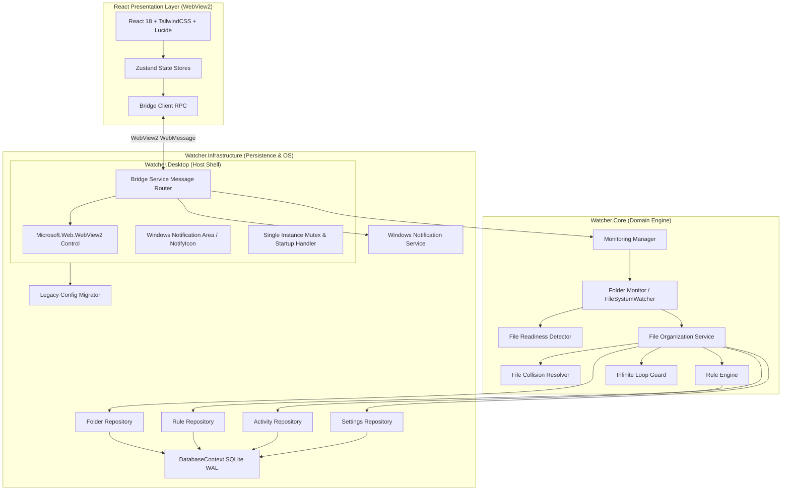

# Watcher 2.0 — System Architecture

## 1. High-Level Architectural Overview

Watcher 2.0 follows a clean, decoupled architecture separating the **Native Windows Host & Shell**, the **Core Organization Engine**, the **Persistence / Infrastructure Layer**, and the **React Presentation Layer**.



---

## 2. Component Details

### A. Presentation Layer (`src/frontend`)
- **Technology**: React 18, TypeScript, Vite, TailwindCSS, Framer Motion, TanStack Table, Recharts.
- **Role**: Renders the Windows 11 Fluent interface entirely inside Microsoft WebView2.
- **Security Boundary**: The frontend has **zero** direct access to the filesystem, shell, or network. All requests are sent as structured, validated JSON RPC messages over the WebView2 bridge.

### B. Communication Bridge (`BridgeService.cs` & `bridgeClient.ts`)
- **Frontend-to-Backend (RPC)**:
  ```typescript
  interface BridgeRequest<T> {
    id: string;
    action: string;
    payload?: T;
    timestamp: string;
  }
  ```
- **Backend-to-Frontend (Events & Responses)**:
  ```typescript
  interface BridgeResponse<T> {
    id: string;
    success: boolean;
    data?: T;
    error?: { code: string; message: string };
  }

  interface BridgeEvent<T> {
    event: string;
    payload: T;
    timestamp: string;
  }
  ```

### C. Core Engine (`Watcher.Core`)
1. **`FileReadinessDetector`**:
   - Solves the common file-lock and premature-move issue present in basic `FileSystemWatcher` implementations.
   - Monitors file size stability across polling intervals.
   - Verifies exclusive read-access before moving.
   - Immediately filters transient downloading files (`.crdownload`, `.part`, `.tmp`, `~$*`).
2. **`FileCollisionResolver`**:
   - Ensures no file is ever silently overwritten.
   - Default behavior (`Rename`): generates numbered suffixes (e.g. `document (1).pdf`).
   - Supports explicit `Skip` or `Replace` behaviors.
3. **`InfiniteLoopGuard`**:
   - Verifies target directories are not cyclic with source watched folders.
   - Recognizes known category subdirectories to avoid reprocessing already sorted files.
4. **`RuleEngine`**:
   - Evaluates file extensions against priority-ordered rules.
   - Maps extensions to appropriate category and destination folder with O(1) cached lookup.

### D. Infrastructure & Persistence (`Watcher.Infrastructure`)
- **SQLite with WAL Mode**: Stores watched folders, rules, categories, application settings, and activity history in `%LOCALAPPDATA%\Watcher\watcher.db`.
- **`LegacyConfigMigrator`**: Reads `~/.watcher_config.json` or `./settings.json` on first launch, migrates existing folders and rule text into SQLite, and guarantees no data loss.
- **`WindowsStartupManager`**: Configures registry key `HKCU\Software\Microsoft\Windows\CurrentVersion\Run` to launch Watcher in background mode.
- **`WindowsNotificationService`**: Native notification area balloon alerts.

---

## 3. Threat Model & Reliability Guarantees
1. **Privileged Operations**: Filesystem moves, folder dialogs, and database operations are executed strictly within the C# process.
2. **Path Sanitization**: All paths received over the bridge are normalized with `Path.GetFullPath()`, checked for existence, and tested against traversal attacks.
3. **Graceful Shutdown**: All `FolderMonitor` workers run on bounded `Channel<string>` queues with cancellation tokens, flushing and closing cleanly on exit.

